<p align="center">
  <a href="https://yamenmorcel.dev"></a>
</p>

<p align="center">
  <a href="https://yamenmorcel.dev"></a>
  <a href="https://linkedin.com/in/yamen-morcel"></a>
  <a href="https://kaggle.com/yamenmorcel"></a>
  <a href="https://github.com/yamen-m?tab=followers"></a>
  
</p>

```yaml
name:      Yamen Morcel
role:      Software Developer
builds:    [web, desktop, embedded]
learning:  Machine Learning
enjoys:    hard problems, new tech
```

### Selected work

<table width="100%">
  <tr>
    <td width="50%" valign="top">
      <a href="https://github.com/Yamen-M/HealthManagementSystem"><b>Health Management System</b></a><br />
      <sub>Desktop app that streamlines appointment booking and medical records.</sub><br />
      <code>C#</code> <code>.NET</code> <code>WinForms</code>
    </td>
    <td width="50%" valign="top">
      <a href="https://github.com/Yamen-M/arduino-sequence-auth"><b>Arduino Sequence Auth</b></a><br />
      <sub>Button-sequence authentication with real-time LED feedback.</sub><br />
      <code>C++</code> <code>Arduino</code> <code>Embedded</code>
    </td>
  </tr>
  <tr>
    <td width="50%" valign="top">
      <a href="https://kelir-games.itch.io/alien-invasion-dogs-rescue"><b>Alien Invasion: Dog's Rescue</b></a><br />
      <sub>Retro run-and-gun side-scroller built by a two-person team for the Gaming Academy 4.0 game jam. <a href="https://kelir-games.itch.io/alien-invasion-dogs-rescue">Play in browser</a> · <a href="https://github.com/Yamen-M/retro-sidescroller">Source</a></sub><br />
      <code>Godot</code> <code>GDScript</code> <code>Game Jam</code>
    </td>
    <td width="50%" valign="top">
      <a href="https://github.com/Yamen-M/Battleship"><b>Battleship</b></a><br />
      <sub>Classic Battleship with an AI opponent and interactive ship placement.</sub><br />
      <code>Web</code> <code>Game AI</code>
    </td>
  </tr>
  <tr>
    <td width="50%" valign="top">
      <a href="https://github.com/Yamen-M/knights-travails"><b>Knights Travails</b></a><br />
      <sub>Shortest knight path on a chessboard using breadth-first search.</sub><br />
      <code>Algorithms</code> <code>BFS</code>
    </td>
    <td width="50%" valign="top">
      <a href="https://github.com/Yamen-M/weather-app"><b>Weather App</b></a><br />
      <sub>Real-time weather with 4-day forecasts and alerts.</sub><br />
      <code>Web</code> <code>REST API</code>
    </td>
  </tr>
</table>

### Toolbox

<picture>
  <source media="(prefers-color-scheme: dark)" srcset="https://skillicons.dev/icons?i=py%2Ccpp%2Ccs%2Cts%2Cjs%2Chtml%2Ccss%2Creact%2Csvelte%2Cnodejs%2Cexpress%2Cdotnet%2Cjest%2Cpostgres%2Cmysql%2Clinux%2Cgit%2Cgodot%2Carduino%2Cfigma&perline=10&theme=dark" />
  
</picture>

### Activity

<p align="center">
  <picture>
    <source media="(prefers-color-scheme: dark)" srcset="https://github-profile-trophy-mu.vercel.app/?username=yamen-m&theme=tokyonight&no-frame=true&no-bg=true&margin-w=8&column=5&title=Experience%2CCommits%2CRepositories%2CFollowers%2CIssues" />
    
  </picture>
</p>

<p align="center">
  <picture>
    <source media="(prefers-color-scheme: dark)" srcset="https://github-readme-stats.vercel.app/api?username=yamen-m&show_icons=true&hide_rank=true&count_private=true&hide_border=true&bg_color=0D1117&title_color=5EEAD4&icon_color=5EEAD4&text_color=C9D1D9" />
    
  </picture>
  <picture>
    <source media="(prefers-color-scheme: dark)" srcset="https://streak-stats.demolab.com?user=Yamen-M&mode=weekly&hide_border=true&background=0D1117&ring=5EEAD4&fire=5EEAD4&currStreakNum=5EEAD4&currStreakLabel=5EEAD4&sideNums=C9D1D9&sideLabels=8B949E&dates=8B949E&stroke=30363D" />
    
  </picture>
</p>

<p align="center"><sub>Thanks for stopping by ✦</sub></p>
